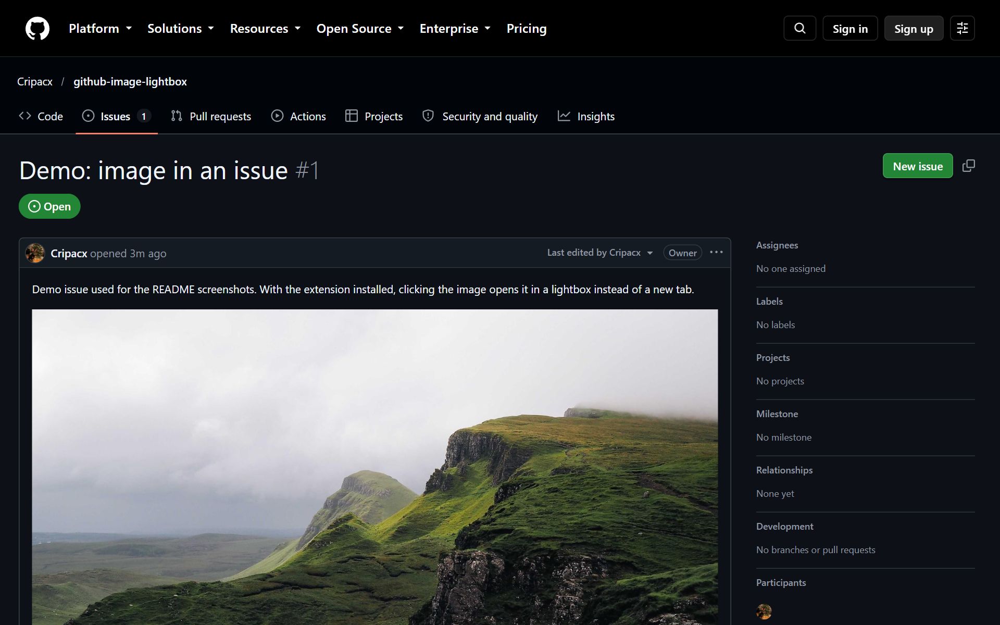
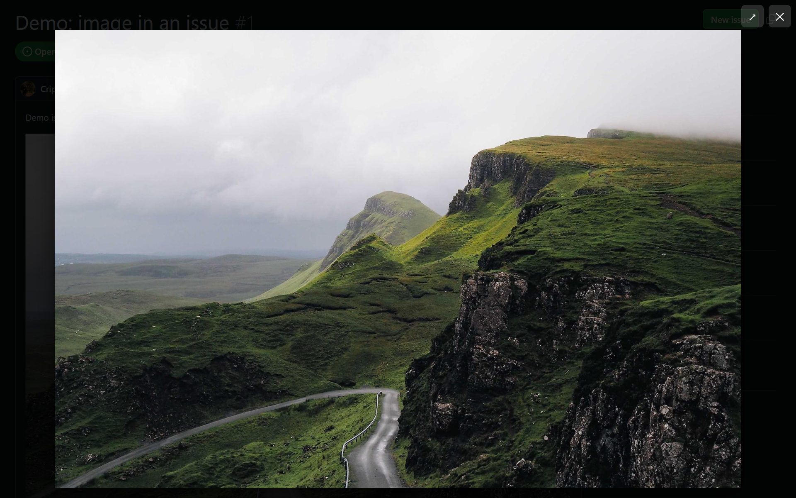

# GitHub Image Lightbox

A tiny Chrome / Edge extension that opens images in GitHub issues, pull requests, comments and READMEs in an **on-page lightbox** instead of a new tab.

By default, GitHub wraps every Markdown image in a link with `target="_blank"`, so clicking a screenshot throws you into a new tab. This extension intercepts that click and shows the image right on the page, the way most websites do.

## Screenshots

**Before:** an image in an issue. A normal click would open a new tab.

**After:** the same click opens the image in a lightbox on top of the page.

**Zoom:** click the image to view large images at full resolution and scroll around.

## Usage

| Action | Result |
| --- | --- |
| Click an image | Opens the lightbox |
| Click the image in the lightbox | Toggles between fit-to-screen and full resolution (scrollable) |
| `Esc`, **✕** or click the dark background | Closes the lightbox |
| **↗** | Opens the original image in a new tab |
| `Ctrl` / `Cmd` / `Shift` + click, or middle click | Native behavior (new tab / window) |

Images that deliberately link somewhere else (for example CI badges in a README) are left alone and still follow their link.

## Installation

The extension is not published in a store. Load it unpacked:

1. Download this repository ([ZIP](https://github.com/Cripacx/github-image-lightbox/archive/refs/heads/main.zip)) and extract it, or `git clone https://github.com/Cripacx/github-image-lightbox.git`
2. Open `chrome://extensions` (Chrome) or `edge://extensions` (Edge)
3. Enable **Developer mode**
4. Click **Load unpacked** and select the extracted folder

Try it on the [demo issue](https://github.com/Cripacx/github-image-lightbox/issues/1).

## Privacy

The extension requests no permissions, runs only on `https://github.com/*`, and makes no network requests of its own. It only displays the image the page has already loaded.

## How it works

A single content script (`content.js`) listens for clicks inside `.markdown-body`. When the clicked link points at the image it wraps (GitHub's automatic image link, including camo-proxied images and `user-attachments`), the default navigation is cancelled and the image is shown in an accessible dialog (`role="dialog"`, focus trap, focus restored on close).

## License

[MIT](LICENSE)
